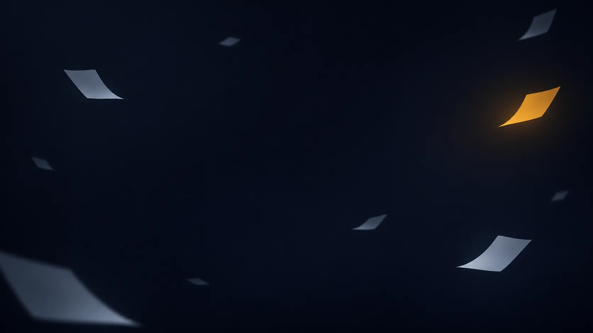

# Brand assets — where the masters live

**One line:** all masters are in [`public/art/`](../public/art) (committed, exact file names). The mission patches
are for the team, not the app: `mission-patch.png` (transparent) and `mission-patch-navy.webp`.

| File | Use | Where |
|---|---|---|
| `hero-ops-room.webp` / `-sm` | Landing hero background (LCP, preloaded) | `src/pages/Home.tsx` |
| `bg-glow.webp` / `-sm` | App ambient background (aurora + grid + grain baked in) | `.ambient` in `src/styles/index.css` |
| `bg-grid-accent.webp` | Guided Demo panel background · OG image base | `Home.tsx`, `public/og-image.png` |
| `bg-constellation.webp` | Landing "How it works" strip | `Home.tsx` (not the Evidence Map — see below) |
| `bg-papers.webp` | Pitch/video "scattered research" moment · this doc's header | Part 6 · docs only, never in-app |
| `flame-sphere.webp` / `-sm` | Landing accent · app loading/empty states, always captioned | `FlameSphereArt` component |
| `logo-flame.webp` | Header brand mark (30px) · favicon source | `AppHeader.tsx`, `public/favicon.ico`, `icon-192/512.png` |
| `mission-patch.png` / `mission-patch-navy.webp` | Video end card · pitch-deck title slide · README header | Part 6 (README uses the PNG) |

## Rules

- These are **branding/decor**. Never present them as NASA experiment data. Evidence-card stills (`media_url`) are
  real NASA public-domain frames from Part 5 only.
- Nothing from this pack inside the Evidence Map plot, Match Panel thumbnails, or the Mission Brief.
- The flame sphere always carries "Illustration — not NASA experiment imagery." (`FlameSphereArt` enforces it.)
- The patch's banner ribbons are intentionally blank. Part 6 adds text in the video editor; never bake text into the masters.
- `bg-constellation` was moved off the Evidence Map backdrop: its orange/blue dots and glowing white node use the
  exact visual language of real outcome dots and the scenario marker, so behind the plot they would read as data.

## Generated files

`public/favicon.ico` (16/32/48), `icon-192.png`, `icon-512.png` (Lanczos from `logo-flame.webp`, cropped to the
ring) and `public/og-image.png` (1200×630: `bg-grid-accent` + logo + "IGNIS" in Space Grotesk Bold + tagline in
IBM Plex Mono). Regenerate only if the masters change.
